<!-- Responsive Light/Dark Banner -->

  <picture>
    <source media="(prefers-color-scheme: dark)" srcset="assets/header-dark.svg">
    
  </picture>

 

# Hey there, I'm Mariem Trigui 👋

 

---

## 🌸 About Me

<table>
<tr>
<td width="65%" valign="middle">

I'm **Mariem Trigui**, a Telecommunications Engineering student at the **National Engineering School of Tunis (ENIT)**, specializing in **Cloud and Cybersecurity**.

I'm passionate about designing secure infrastructures, exploring offensive and defensive security, and building practical cybersecurity solutions.

- 🎓 Telecommunications Engineering Student @ ENIT
- 🔐 Interested in Cloud Security & Network Defense
- ☁️ Exploring AWS, Azure & GCP
- 🛡️ Hands-on experience with penetration testing and SOC environments
- 🐳 Building containerized security infrastructures
- 🏴‍☠️ Practicing through CTFs and security labs
- 🚀 Always learning, experimenting and building

**Current interests:** Cloud Security · Network Security · Penetration Testing · SIEM · Threat Detection · Secure Infrastructure

</td>
<td width="35%" align="center" valign="middle">

  

**Based in Tunisia 🇹🇳**

</td>
</tr>
</table>

---

## 🛠️ Tech Stack

### Cybersecurity & Security Tools

  

### Cloud & Infrastructure

  

### Networking & Monitoring

  

### Programming & Development

**Additional tools:** Wazuh · Suricata · Zabbix · Wireshark · Burp Suite · OWASP ZAP · Nmap · Metasploit · Zenarmor · OPNsense · FRRouting · FastAPI · SQLAlchemy · PostgreSQL

---

## 🚀 Featured Projects

  Automated security auditing and posture assessment across AWS, Azure and GCP,
  identifying misconfigurations and providing actionable remediation.

  

  Developed a hands-on cybersecurity learning platform featuring vulnerable labs,
  guided learning paths, flag validation and Docker Swarm orchestration.

  

  Designed a virtualized security infrastructure integrating centralized monitoring,
  intrusion detection, network security and Active Directory.

  

  Built a containerized network monitoring infrastructure with host and network-based
  intrusion detection, traffic analysis and QoS monitoring.

  

  Implemented reinforcement learning algorithms for adaptive intrusion detection
  and automated traffic-response decisions.

## 📊 GitHub Statistics

  

---

## 🐍 Contribution Snake

<!--
GitHub Action required:
Create .github/workflows/snake.yml in your profile repository.
The workflow generates the contribution snake SVG and commits it to the output branch.
-->

---

## 🤝 Let's Connect!

I'm always open to connecting with cybersecurity enthusiasts, engineers, researchers and potential collaborators.

 

 

  

---

### 💗 Thanks for visiting my profile!

